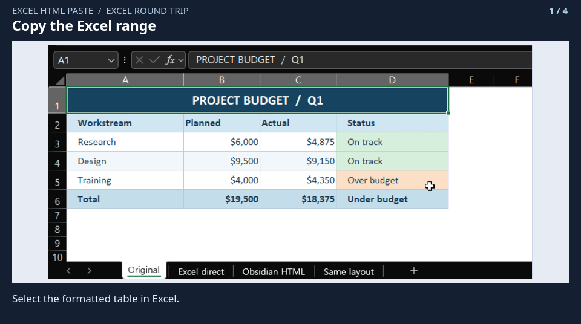

# Excel HTML Paste

[English](README.md)

Excel에서 복사한 표를 Obsidian 문서에 관리형 asset으로 붙여넣는 Obsidian 플러그인입니다. 클립보드의 `text/html`과 `image/png`를 읽어 vault 안에 저장하고, 문서에는 asset을 가리키는 코드블럭을 삽입합니다.

## 빠른 시작

- Windows x64에서 표를 Excel로 다시 붙여넣을 때 서식을 더 안정적으로 유지하려면 `with-helper` ZIP을 선택하세요. 실행 파일 없이 기본 기능을 사용하려면 `no-helper` ZIP을 선택하세요. [GitHub Releases에서 내려받기](https://github.com/SMOKE-19/obsidian-excel-html-paste/releases/latest)
- 선택 구성인 helper의 Rust 소스와 GitHub Actions 빌드 설정은 이 저장소에 공개되어 있습니다. [Helper 소스](helper/src/main.rs) · [빌드 워크플로](.github/workflows/build-plugin.yml) · [직접 빌드](helper/README.md)
- [Windows 설치 방법](#설치-방법)을 따라 설치한 뒤 [Excel → Obsidian → Excel 사용 흐름](#사용-흐름)을 따라 해 보세요.

## 주요 기능

- 편집기 우클릭 메뉴의 `Excel 표(HTML) 붙여넣기` 명령 제공
- Excel HTML 원본을 `table.html`로 저장
- 클립보드 이미지가 있으면 `table.png` 미리보기로 저장
- 검색용 Markdown 인덱스 `table.search.md` 생성
- 읽기 모드에서 `excel-html-asset` 코드블럭을 이미지 미리보기로 렌더링
- 렌더링된 asset의 `HTML` 버튼으로 원본 HTML을 서식 포함 클립보드에 복사
- 렌더링된 asset 우클릭 메뉴에서 이력 보관 교체, 완전 교체, 삭제 지원
- Windows 환경에서는 native clipboard helper를 통해 CF_HTML 읽기/쓰기를 보강

## 왜 Markdown 표로 변환하지 않나요?

이 플러그인은 Excel-to-Markdown 변환 플러그인을 대체하려는 도구가 아닙니다. Markdown 편집성보다 Excel의 시각적 서식 보존이 더 중요한 경우를 위해 설계했습니다.

다음과 같은 경우에 이 플러그인이 잘 맞습니다.

- 표에 병합 셀이 포함된 경우
- 색상, 테두리, 열 너비, 배치 자체가 중요한 의미를 가지는 경우
- 표가 너무 넓거나 복잡해서 Markdown 표로 편집하기 불편한 경우
- Excel HTML 원본 표현을 vault asset으로 보관하고 싶은 경우
- 생성된 `table.search.md` 보조 파일을 통해 Obsidian 검색도 함께 사용하고 싶은 경우

편집 가능한 Markdown 표가 필요하다면 Excel-to-Markdown 플러그인이 더 적합합니다. 시각적 미리보기와 HTML 원본 보존이 중요하다면 이 플러그인이 의도한 사용처입니다.

## Windows helper 유무에 따른 UX

이 플러그인은 helper 없이도 기본 기능을 사용할 수 있습니다. 다만 Windows에서 Excel과 HTML 서식을 왕복하는 품질은 helper가 있을 때 가장 안정적입니다.

helper는 작은 Rust native 실행 파일입니다. Windows의 `HTML Format` 클립보드 포맷, 즉 CF_HTML을 직접 읽고 씁니다. CF_HTML은 단순 HTML 문자열이 아니라 `StartHTML`, `EndHTML`, `StartFragment`, `EndFragment` 오프셋 헤더가 포함된 Windows 전용 클립보드 포맷입니다. Excel은 이 포맷을 브라우저 표준 `text/html`보다 안정적으로 해석하는 경우가 많습니다.

### helper가 없을 때

- `Excel 표(HTML) 붙여넣기`는 브라우저/Electron Clipboard API로 `text/html`과 `image/png`를 읽습니다.
- asset 생성, 이미지 미리보기, `table.html`, `table.search.md`, 교체/삭제 기능은 그대로 동작합니다.
- `HTML` 버튼은 표준 Clipboard API로 `text/html`과 `text/plain`을 클립보드에 씁니다.
- 브라우저, 메일, 문서 편집기 등에 HTML로 붙여넣는 용도는 동작할 가능성이 높습니다.
- Excel에 다시 붙여넣을 때는 환경에 따라 표 구조만 유지되거나, 서식/병합/폭/색상 일부가 깨질 수 있습니다.
- helper가 없거나 실행에 실패하면 플러그인은 자동으로 이 fallback 경로를 사용하고, 가능한 경우 `Notice`로 안내합니다.

### helper가 있을 때

- Windows Desktop 환경에서 helper 실행 파일을 찾으면, Excel 클립보드 HTML을 native CF_HTML 경로로 먼저 읽습니다.
- `HTML` 버튼을 누르면 저장된 HTML을 Windows `HTML Format`으로 클립보드에 직접 씁니다.
- 동시에 `CF_UNICODETEXT`, `CF_TEXT`, `CF_OEMTEXT` fallback도 함께 설정해 Excel 외 앱에서도 붙여넣기 가능성을 높입니다.
- Excel에 다시 붙여넣을 때 표 구조와 HTML 서식이 유지될 가능성이 helper 없는 경로보다 높습니다.
- helper는 Windows에서만 사용되며, macOS/Linux 또는 helper가 없는 Windows 환경에서는 표준 Clipboard API fallback으로 동작합니다.

### 사용자가 체감하는 차이

| 작업 | helper 없음 | helper 있음 |
| --- | --- | --- |
| Obsidian에 Excel 표 저장 | 동작 | 동작 |
| 이미지 미리보기 렌더링 | 동작 | 동작 |
| 검색용 `table.search.md` 생성 | 동작 | 동작 |
| asset 교체/삭제 | 동작 | 동작 |
| HTML을 브라우저/문서 앱에 복사 | 대체로 동작 | 대체로 동작 |
| HTML을 Excel에 다시 붙여넣기 | 환경 의존 | 더 안정적 |
| Excel 원본 수준 서식 왕복 | 보장 어려움 | 가장 권장되는 경로 |

정리하면, helper는 기본 저장 기능을 위한 필수 요소가 아니라 **Windows Excel 서식 왕복 품질을 높이는 선택 구성**입니다.

## 사용 흐름



Excel에서 표 범위를 선택하고 **Ctrl+C**로 복사한 뒤 Obsidian 편집기에서 우클릭하고 `Excel 표(HTML) 붙여넣기`를 선택합니다. 노트에 표가 나타난 뒤 보기 모드를 전환합니다.

플러그인은 Obsidian의 `파일 및 링크 → 첨부 파일 폴더 경로`가 설정되어 있으면 해당 폴더 아래에 asset 폴더를 만들고, 현재 문서에는 코드블럭을 삽입합니다. 첨부 파일 폴더가 지정되지 않았거나 경로를 확인할 수 없으면 기존 기본 경로를 사용합니다.

```text
{첨부 파일 폴더}/excel-paste/{id}/
  meta.json
  table.html
  table.png
  table.search.md
```

기본 폴백 경로는 `assets/excel-paste/{id}/`입니다.

문서에는 다음 형태의 코드블럭이 들어갑니다.

````markdown
```excel-html-asset
path: assets/excel-paste/{id}/meta.json
```
````

**읽기 모드**로 전환하면 표 미리보기가 나타납니다. 미리보기의 **HTML**을 누른 뒤 Excel에서 대상 셀을 선택하고 **Ctrl+V**로 붙여넣습니다. 클립보드에 이미지가 없으면 Obsidian이 HTML만 저장되었다는 안내와 **HTML** 복사 버튼을 표시합니다.

Windows 시연에는 `with-helper` ZIP을 사용했습니다. Excel로 다시 붙여넣은 뒤에도 병합 제목 셀, 채우기 색상, 테두리, 숫자 서식이 유지됩니다. 시연에서는 원본과 열 너비·행 높이가 같은 시트에 붙여넣었습니다. 빈 시트에서는 대상 시트의 너비와 높이가 적용되어 같은 표도 더 좁거나 낮게 보일 수 있습니다.

## Asset 관리

렌더링된 Excel asset 위에서 우클릭하면 다음 작업을 할 수 있습니다.

- `이력 남기고 Excel 표(HTML) 교체`: 기존 `table.html`, `table.png`, `table.search.md`, `meta.json`을 timestamp가 붙은 파일명으로 보관한 뒤 새 클립보드 내용으로 교체합니다.
- `Excel 표(HTML) 완전 교체`: 기존 활성 파일을 새 클립보드 내용으로 덮어쓰고, 이전 이력 파일을 삭제합니다.
- `Excel asset 삭제`: 문서의 코드블럭과 연결된 asset 폴더를 함께 삭제합니다.

교체 중 오류가 나면 가능한 범위에서 이전 파일을 복원하도록 rollback 처리가 들어 있습니다.

## 프로젝트 구조

- `main.ts`: Obsidian 플러그인 진입점, 클립보드 처리, asset 생성/렌더링/교체/삭제 로직
- `styles.css`: 렌더링된 Excel 이미지, HTML 복사 버튼, 오류/fallback 표시 스타일
- `manifest.json`: Obsidian 플러그인 메타데이터
- `esbuild.config.mjs`: `main.ts`를 `main.js`로 번들링하는 설정
- `.github/workflows/build-plugin.yml`: GitHub Actions에서 배포 산출물을 만들고 태그 Release에 첨부
- `helper/`: Windows CF_HTML 읽기/쓰기를 위한 Rust native helper
- `bin/`: 배포 시 native helper 실행 파일을 두는 위치

## 빌드

의존성을 설치합니다.

```bash
npm install
```

플러그인 JavaScript를 빌드합니다.

```bash
npm run build
```

`main.js`는 생성된 번들 파일입니다. Git에는 커밋하지 않고, GitHub Actions가 Release 산출물로 생성합니다.

Windows native helper를 빌드할 때는 Rust toolchain이 필요합니다.

```bash
npm run build:helper:win64
```

빌드된 helper 실행 파일은 배포 전에 다음 위치에 맞춰 둡니다.

```text
bin/excel-html-clipboard-win32-x64.exe
```

arm64 Windows용 helper는 다음 이름을 사용합니다.

```text
bin/excel-html-clipboard-win32-arm64.exe
```

## 설치 방법

1. Windows 설치 파일을 내려받아 실행하고, Obsidian에서 로컬 보관함을 열거나 만듭니다. [Obsidian 다운로드](https://obsidian.md/download)
2. 플러그인 ZIP을 내려받아 파일 탐색기에서 **압축 풀기**를 실행합니다. [Excel HTML Paste Releases](https://github.com/SMOKE-19/obsidian-excel-html-paste/releases/latest)
3. 압축을 푼 `excel-html-paste` 폴더를 보관함의 `.obsidian/plugins/`에 복사합니다. `plugins` 폴더가 없으면 만듭니다.
4. Obsidian의 **설정 → 커뮤니티 플러그인**에서 사용을 허용하고, **설치된 플러그인** 목록에서 **Excel HTML Paste**를 켭니다. 목록에 나타나지 않으면 새로고침합니다.

`with-helper` ZIP을 설치하면 아래 구조가 됩니다.

```text
.obsidian/plugins/excel-html-paste/
  manifest.json
  main.js
  styles.css
  bin/
    excel-html-clipboard-win32-x64.exe
```

`no-helper` ZIP에는 플러그인 파일 세 개가 들어 있습니다. 직접 빌드한 helper를 사용하려면 위 구조의 `bin/`에 실행 파일을 넣습니다. [Helper 빌드 방법](helper/README.md)

## 동작 메모

- 플러그인은 Desktop 전용입니다.
- 플러그인 UI는 기본적으로 영어를 사용하고, Obsidian 언어가 `ko`로 시작하면 메뉴, Notice, 확인창, 플러그인 렌더링 오류가 한국어로 표시됩니다.
- 클립보드에 `text/html`이 없으면 붙여넣기를 중단합니다.
- 클립보드에 이미지가 없으면 HTML 원본과 검색용 Markdown만 저장합니다.
- 생성되는 asset은 Obsidian의 `attachmentFolderPath` 설정을 해석한 폴더의 `excel-paste/` 아래에 저장됩니다. `/`는 Vault 루트, `./`는 현재 문서 폴더, `./attachments`는 현재 문서 폴더 아래의 `attachments`를 뜻합니다. 설정을 읽을 수 없거나 경로가 안전하지 않은 경우에만 기존 `assets/excel-paste/`로 폴백합니다.
- `.assets`처럼 점으로 시작하는 숨김 폴더도 저장, 렌더링, HTML 복사, 교체, 삭제에 사용할 수 있습니다. 플러그인은 이 경로의 파일을 Adapter API로 직접 처리하지만, Obsidian 검색 인덱스에서는 제외될 수 있습니다.
- `table.search.md`는 Obsidian 검색에 걸리도록 HTML table 내용을 Markdown table 형태로 변환한 보조 파일입니다.
