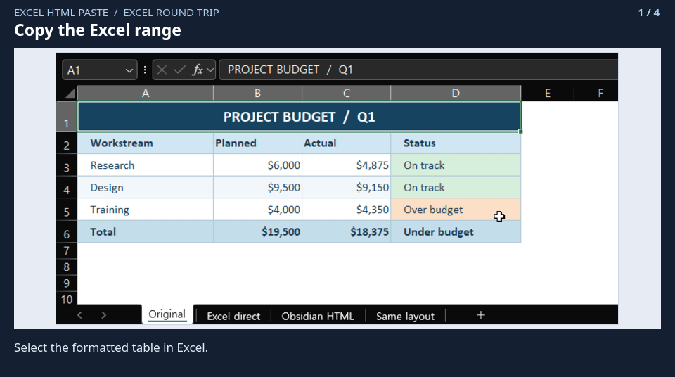
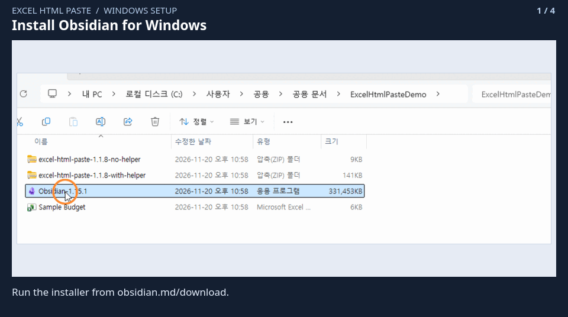

# Excel HTML Paste

[한국어](README.ko.md)

Excel HTML Paste is an Obsidian plugin that stores tables copied from Excel as managed assets in your vault. It reads `text/html` and `image/png` from the clipboard, saves them under the vault, and inserts a code block that points to the managed asset.

## Quick Start

- On Windows x64, choose the `with-helper` ZIP for more reliable Excel formatting when copying a table back to Excel. Choose `no-helper` to use the basic workflow without the helper executable. [Download from Releases](https://github.com/SMOKE-19/obsidian-excel-html-paste/releases/latest)
- The optional helper's Rust source and GitHub Actions build are published in this repository. [Helper source](helper/src/main.rs) · [Build workflow](.github/workflows/build-plugin.yml) · [Build it yourself](helper/README.md)
- Follow [Windows installation](#installation), then try the [Excel → Obsidian → Excel workflow](#usage-flow).

## Features

- Adds an editor context-menu command: `Paste Excel table (HTML)`
- Stores the original Excel HTML as `table.html`
- Stores the clipboard image as `table.png` when available
- Creates a searchable Markdown index file, `table.search.md`
- Renders `excel-html-asset` code blocks as image previews in Reading view
- Provides an `HTML` button on rendered assets to copy the original HTML back to the clipboard
- Provides rendered-asset context-menu actions for history-preserving replacement, full replacement, and deletion
- On Windows, improves CF_HTML read/write behavior through a native clipboard helper

## Why Not Markdown Tables?

This plugin is not intended to replace Excel-to-Markdown conversion plugins. It is designed for cases where preserving Excel's visual formatting matters more than Markdown editability.

Use this plugin when:

- the table contains merged cells
- colors, borders, widths, or layout carry important meaning
- the table is too wide or visually complex for comfortable Markdown editing
- you want to keep the original Excel HTML representation as a vault asset
- you still want Obsidian search support through a generated `table.search.md` sidecar file

If you want an editable Markdown table, an Excel-to-Markdown plugin is usually a better fit. If you want a faithful visual preview plus preserved HTML source, this plugin is the intended tool.

## UX With And Without The Windows Helper

The plugin can be used without the helper. The helper is not required for the basic asset workflow. However, on Windows, round-tripping Excel HTML formatting is most reliable when the helper is available.

The helper is a small Rust native executable. It directly reads and writes the Windows `HTML Format` clipboard format, also known as CF_HTML. CF_HTML is not just a plain HTML string. It includes Windows-specific offset headers such as `StartHTML`, `EndHTML`, `StartFragment`, and `EndFragment`. Excel often handles this format more consistently than standard browser `text/html` clipboard data.

### Without The Helper

- `Paste Excel table (HTML)` reads `text/html` and `image/png` through the browser/Electron Clipboard API.
- Asset creation, image preview, `table.html`, `table.search.md`, replacement, and deletion still work.
- The `HTML` button writes `text/html` and `text/plain` through the standard Clipboard API.
- Copying HTML into browsers, mail clients, and document editors will usually work.
- Pasting back into Excel is environment-dependent. The table structure may survive, but formatting, merged cells, widths, colors, or Excel-specific details may be degraded.
- If the helper is missing or fails, the plugin automatically falls back to this path and shows a `Notice` when possible.

### With The Helper

- On Windows Desktop, when the helper executable is found, the plugin first reads Excel clipboard HTML through the native CF_HTML path.
- When the `HTML` button is clicked, the saved HTML is written directly to the Windows `HTML Format` clipboard format.
- The helper also sets `CF_UNICODETEXT`, `CF_TEXT`, and `CF_OEMTEXT` fallback formats to improve paste compatibility with non-Excel applications.
- Pasting back into Excel is more likely to preserve table structure and HTML formatting than the helperless path.
- The helper is used only on Windows. On macOS, Linux, or Windows installations without the helper, the plugin falls back to the standard Clipboard API.

### Practical Difference

| Task | Without helper | With helper |
| --- | --- | --- |
| Save an Excel table into Obsidian | Works | Works |
| Render image previews | Works | Works |
| Create `table.search.md` | Works | Works |
| Replace/delete managed assets | Works | Works |
| Copy HTML into browsers or document apps | Usually works | Usually works |
| Paste HTML back into Excel | Environment-dependent | More reliable |
| Preserve Excel-like formatting round-trip | Hard to guarantee | Recommended path |

In short, the helper is an optional component for improving **Windows Excel formatting round-trip quality**. It is not required for the core asset storage workflow.

## Usage Flow



Copy a range in Excel with **Ctrl+C**, right-click in the Obsidian editor, and choose `Paste Excel table (HTML)`. Wait for the asset to appear in the note before switching views.

When Obsidian's **Files and links → Default location for new attachments** is configured, the plugin creates its asset folder under that location and inserts a code block into the current note. If no attachment folder is configured or the path cannot be resolved, it uses the legacy default path.

```text
{attachment folder}/excel-paste/{id}/
  meta.json
  table.html
  table.png
  table.search.md
```

The fallback path is `assets/excel-paste/{id}/`.

The inserted note content looks like this:

````markdown
```excel-html-asset
path: assets/excel-paste/{id}/meta.json
```
````

Switch to **Reading view** to see the table preview. Click **HTML** on the preview, return to Excel, select a destination cell, and paste with **Ctrl+V**. If Excel supplies no clipboard image, Obsidian shows an HTML-only fallback with the same **HTML** copy button.

The Windows demo uses the `with-helper` ZIP. The sample's merged header, fill colors, and borders are visible after pasting back into Excel. The destination column widths can differ. To fit them to the text, select the pasted columns and double-click a column heading boundary.

## Asset Management

Right-click a rendered Excel asset to access these actions:

- `Replace Excel table (HTML), keep history`: Archives the current `table.html`, `table.png`, `table.search.md`, and `meta.json` with timestamped filenames, then replaces the active files with the current clipboard content.
- `Replace Excel table (HTML) completely`: Overwrites the active files with the current clipboard content and deletes previous history files.
- `Delete Excel asset`: Removes the code block from the note and deletes the linked asset folder.

Replacement operations include rollback handling where possible, so existing files are restored if replacement fails partway through.

## Project Structure

- `main.ts`: Obsidian plugin entrypoint, clipboard handling, asset creation/rendering/replacement/deletion logic
- `styles.css`: Styles for rendered Excel images, the HTML copy button, fallback states, and error states
- `manifest.json`: Obsidian plugin metadata
- `esbuild.config.mjs`: Bundles `main.ts` into `main.js`
- `.github/workflows/build-plugin.yml`: Builds release artifacts with GitHub Actions and attaches them to tagged Releases
- `helper/`: Rust native helper for Windows CF_HTML read/write support
- `bin/`: Target location for packaged native helper executables

## Build

Install dependencies.

```bash
npm install
```

Build the Obsidian plugin JavaScript.

```bash
npm run build
```

`main.js` is a generated bundle. It is ignored by Git and produced by GitHub Actions for Release artifacts.

Building the Windows native helper requires the Rust toolchain.

```bash
npm run build:helper:win64
```

Place the built helper executable at this path before packaging.

```text
bin/excel-html-clipboard-win32-x64.exe
```

The arm64 Windows helper should use this filename.

```text
bin/excel-html-clipboard-win32-arm64.exe
```

## Installation



1. Download the Windows installer, run it, and open or create a local vault in Obsidian. [Obsidian downloads](https://obsidian.md/download)
2. Download a plugin ZIP and use **Extract All** in File Explorer. [Excel HTML Paste Releases](https://github.com/SMOKE-19/obsidian-excel-html-paste/releases/latest)
3. Copy the extracted `excel-html-paste` folder into your vault's `.obsidian/plugins/` directory. Create `plugins` if needed.
4. In Obsidian, open **Settings → Community plugins**, turn on community plugins if prompted, and enable **Excel HTML Paste** under **Installed plugins**. Refresh the list if the plugin does not appear.

The `with-helper` ZIP produces this layout.

```text
.obsidian/plugins/excel-html-paste/
  manifest.json
  main.js
  styles.css
  bin/
    excel-html-clipboard-win32-x64.exe
```

The `no-helper` ZIP provides the three plugin files. To install a self-built helper, place the executable under `bin/` as shown above. [Build instructions](helper/README.md)

## Behavior Notes

- The plugin is desktop-only.
- The plugin uses English UI text by default. When Obsidian's language starts with `ko`, menus, notices, confirmations, and plugin-rendered errors are shown in Korean.
- If the clipboard does not contain `text/html`, paste is aborted.
- If the clipboard does not contain an image, only the HTML source and searchable Markdown index are stored.
- Generated assets are stored under `excel-paste/` in the folder resolved from Obsidian's `attachmentFolderPath` setting. `/` means the Vault root, `./` means the current note's folder, and `./attachments` means an `attachments` folder below the current note's folder. The legacy `assets/excel-paste/` path is used only when the setting cannot be read or is unsafe.
- Dot-prefixed hidden folders such as `.assets` support storage, rendering, HTML copy, replacement, and deletion. The plugin accesses files in these paths directly through the Adapter API, but Obsidian may exclude them from its search index.
- `table.search.md` is a sidecar Markdown file that converts HTML table content into Markdown table text so Obsidian search can index it.
